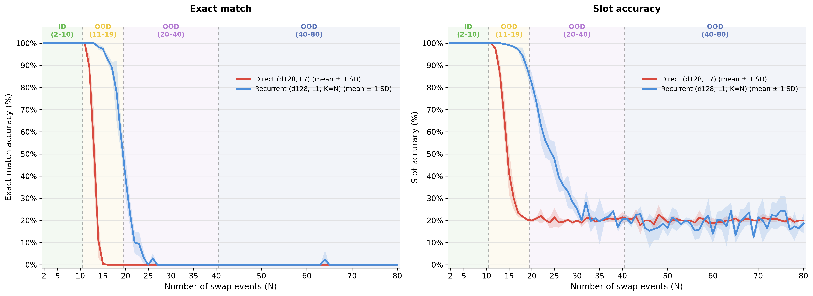

# Recurrent Transformers for Length Generalization in State Tracking

Code and experiment configurations for studying length generalization in
recurrent Transformers on a five-slot permutation state-tracking task.

Models are trained on sequences containing **2–10 swap events** and evaluated
on held-out ID examples and increasingly long OOD sequences:

| Split | Number of swaps | Purpose |
| --- | ---: | --- |
| Train | 2–10 | Training distribution |
| ID | 2–10 | Held-out in-distribution evaluation |
| OOD 11–19 | 11–19 | Near-range length extrapolation |
| OOD 20–40 | 20–40 | Moderate length extrapolation |
| OOD 40–80 | 40–80 | Long-range length extrapolation |

The principal comparison uses an Atomic+NoPE recurrent Transformer with one
shared block (`d128 L1`, `K=N`) and a compute-matched fixed-depth Transformer
(`d128 L7`). Here, `N` is the number of swap events and `K` is the number of
recurrent applications at inference time.

---

## Main results

### Recurrence vs. fixed depth

Both models fit the held-out ID split, but their behavior separates immediately
beyond the training horizon. Lines show the mean across seeds 0, 1, and 2; the
shaded regions show ±1 sample standard deviation across seeds.



The corresponding split-level results are shown as **exact match / slot
accuracy (%)**:

| Model | ID 2–10 | OOD 11–19 | OOD 20–40 | OOD 40–80 |
| --- | ---: | ---: | ---: | ---: |
| Direct `d128 L7` | 100.0 / 100.0 | 28.1 / 53.9 | 0.0 / 20.2 | 0.0 / 20.1 |
| Recurrent `d128 L1`, `K=N` | **100.0 / 100.0** | **90.6 / 97.5** | **4.6 / 36.1** | **0.1 / 19.1** |

Recurrence substantially moves the length-generalization boundary, although
neither model generalizes meaningfully to 40–80 swaps.

---

### Input representation × positional encoding

The recurrent architecture alone is not sufficient. Atomic operation tokens
and the positional scheme strongly determine whether the shared transition can
be reused beyond the training range. Values are seed means reported as **exact
match / slot accuracy (%)**.

| Input representation | Positional encoding | ID 2–10 | OOD 11–19 | OOD 20–40 | OOD 40–80 |
| --- | --- | ---: | ---: | ---: | ---: |
| Template | NoPE | 0.0 / 20.1 | 0.0 / 19.9 | 0.0 / 19.9 | 0.0 / 19.0 |
| Template | Absolute sinusoidal | 100.0 / 100.0 | 0.3 / 27.8 | 0.0 / 20.6 | 0.0 / 19.8 |
| Atomic | NoPE | **100.0 / 100.0** | **90.6 / 97.5** | **4.6 / 36.1** | 0.1 / 19.1 |
| Atomic | Absolute sinusoidal | 100.0 / 100.0 | 18.0 / 46.6 | 0.0 / 21.0 | 0.0 / 20.4 |

---

### Recurrent capacity scaling

Increasing recurrent capacity extends the useful extrapolation range more
effectively than increasing fixed depth. Values are **exact match / slot
accuracy (%)**.

| Model | OOD 11–19 | OOD 20–40 |
| --- | ---: | ---: |
| Recurrent `d128 L1` | 90.6 / 97.5 | 4.6 / 36.1 |
| Recurrent `d256 L4` | **99.4 / 99.9** | **35.1 / 66.1** |
| Direct `d256 L12` | 38.1 / 63.9 | 0.0 / 20.7 |

The figure can be regenerated from the included seed-level JSON files:

```bash
uv run --extra analysis python scripts/plot_main_length_generalization.py
```

The raw per-length results and aggregated mean/SD CSV are stored in
[`results/paper/main`](results/paper/main).

---

## Setup

Python 3.10 or later and [uv](https://docs.astral.sh/uv/) are recommended.

```bash
uv sync --extra dev
uv run pytest
```

---

## YAML-first workflow

All documented dataset, training, and checkpoint-evaluation runs are configured
through YAML. Relative paths inside a YAML file are interpreted from the
repository root. Explicit CLI options remain available as temporary overrides,
but they are not required for the commands below.

### 1. Generate the paper datasets

The generated JSONL files are already included under `data/`. To regenerate
them deterministically:

```bash
uv run python -m src.data.data --config configs/data/paper_h10.yaml
uv run python -m src.data.data --config configs/data/boundary_11_19.yaml
uv run python -m src.data.verify
```

`boundary_11_19.yaml` uses the inclusive range 11–19 and creates
`data/boundary_sweep/boundary_11_19.jsonl` with 100 examples per length.

### 2. Train the main models

Each paper config runs seeds 0, 1, and 2 and records the complete resolved
configuration beside its checkpoint.

```bash
uv run python main.py --config configs/paper/recurrent_d128_l1_atomic_nope.yaml
uv run python main.py --config configs/paper/direct_d128_l7_atomic_nope.yaml
```

The recurrent configuration uses the primary length-matched rule `K=N` and
final-state supervision only. The Direct model uses independent Transformer
blocks and the same Atomic+NoPE input condition.

### 3. Run the representation × positional-encoding ablation

The four recurrent `d128 L1` conditions from the paper are:

```bash
uv run python main.py --config configs/paper/recurrent_d128_l1_template_nope.yaml
uv run python main.py --config configs/paper/recurrent_d128_l1_template_sinusoidal.yaml
uv run python main.py --config configs/paper/recurrent_d128_l1_atomic_nope.yaml
uv run python main.py --config configs/paper/recurrent_d128_l1_atomic_sinusoidal.yaml
```

### 4. Evaluate saved checkpoints

Evaluation YAML files contain the checkpoint, dataset, split, recurrence rule,
batch size, fixed-loop diagnostic sweep, and output path. The provided files
point to seed 0; change only the `checkpoint` and `output` fields to evaluate
another seed.

```bash
# Recurrent d128 L1, K=N and fixed-loop diagnostics
uv run python scripts/evaluate_length_matched_checkpoint.py --config configs/evaluation/recurrent_d128_l1_boundary.yaml
uv run python scripts/evaluate_length_matched_checkpoint.py --config configs/evaluation/recurrent_d128_l1_ood.yaml

# Compute-matched Direct d128 L7
uv run python scripts/evaluate_direct_checkpoint.py --config configs/evaluation/direct_d128_l7_boundary.yaml
uv run python scripts/evaluate_direct_checkpoint.py --config configs/evaluation/direct_d128_l7_ood.yaml
```

The original long-form CLI remains backward compatible. When a YAML config and
CLI option are both supplied, the explicit CLI value takes precedence.

---

## Evaluation metrics

- **Exact match:** an example is correct only when all five final slot states
  are predicted correctly.
- **Slot accuracy:** the fraction of individual slot states predicted
  correctly.

Reported paper results aggregate seeds 0, 1, and 2. Error bars denote one
sample standard deviation across these independently seeded runs (`ddof=1`).

---

## Configuration layout

```text
configs/
├── data/          # deterministic paper dataset generation
├── paper/         # main models and representation/PE ablations
├── evaluation/    # checkpoint-only ID/OOD evaluation
└── *.yaml         # legacy and supplementary experiment configurations
```

Important fields are grouped by purpose:

```yaml
architecture: fan-recurrent
position_encoding: none
fan_input_format: atomic

model:
  d_model: 128
  n_heads: 4
  d_ff: 512
  num_layers: 1

training:
  seeds: [0, 1, 2]
  train_steps: 100000
  curriculum_min_swaps: 2
  curriculum_max_swaps: 10
  swaps_per_loop: 1

evaluation:
  splits: [id_test, ood_x4, ood_x8]
  batch_size: 128
```

---

## Outputs

Training runs are written under `runs/original/`. Each run stores its resolved
arguments, model configuration, metrics, result summary, and checkpoint. The
checkpoint-only evaluators write JSON results to the path specified by their
evaluation YAML.

---

## Repository structure

```text
configs/            YAML experiment definitions
data/               train, ID, boundary, OOD 20–40, and OOD 40–80 JSONL
docs/               dataset and implementation notes
scripts/            evaluation, aggregation, and plotting utilities
src/data/           deterministic data generation and tokenization
src/model/          fixed-depth and recurrent Transformer modules
src/original/       primary permutation state-tracking experiments
src/systematic/     supplementary controlled state-tracking experiments
tests/              data, model, training, and configuration tests
```

The implementation retains the older direct CLI for compatibility, while the
YAML files above are the canonical commands for reproducing the paper results.
