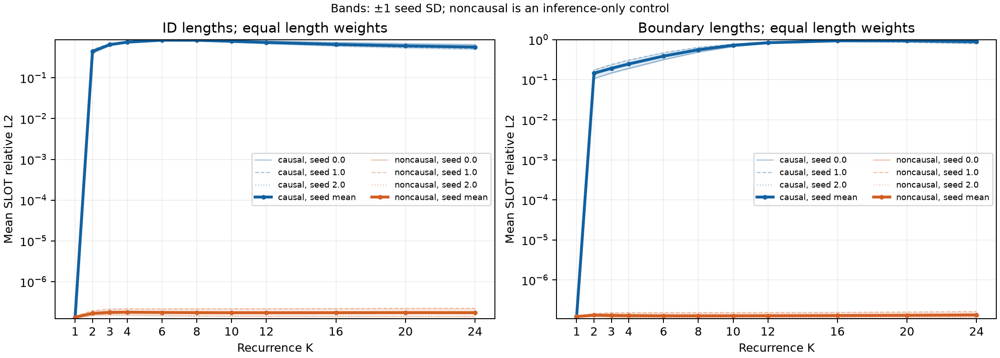
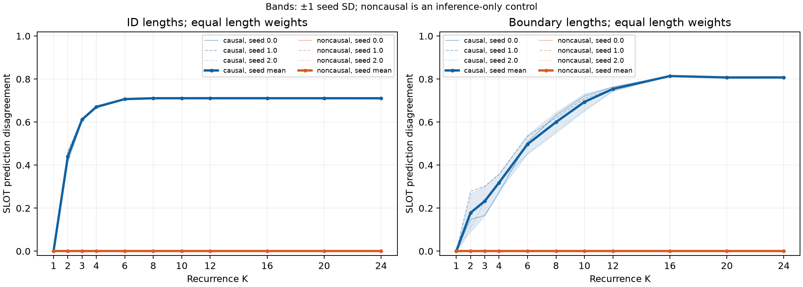
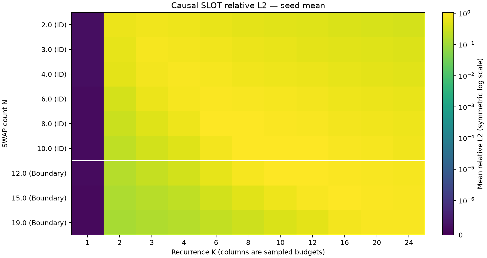

# Causal attention 사건 순서 정보 전달 실험

## 확인된 결론

Drive의 학습 체크포인트 seeds [0, 1, 2], 9개 길이×200쌍, K=1..24를 평가했다(재학습 없음). 총 259,200개의 pair/seed/조건/K 행과 54개 tensor archive를 저장했다.
- **H1:** causal K=1 SLOT hidden·normalized·logits·probabilities의 순열 불변성 검사를 모두 통과했다. raw hidden의 최대 relative L2는 5.08×10⁻⁷이었다.
- **H2/H4의 순서 반응:** 5,400개 seed×pair 모두 최초 SLOT hidden 차이가 K=2에서 나타났다. K=2 평균 relative L2는 0.3457. K=1 SWAP에서 먼저 차이가 나타났으며, 해당 SWAP hidden 차이를 제거한 전달 통제에서는 K=2 SLOT relative L2가 4.46e-16로 사라졌다.
- **H3의 수치 검증:** noncausal hidden·normalized·logits는 전체 K에서 float32 기준을 통과했다. probabilities의 31개 오차 기준 초과는 보존했다. 영향받은 seed/길이의 모든 pair를 float64로 재평가한 6,464개 검사에서 실패 0개였고, 최대 probability relative L2는 8.96e-14였다.
- **올바른 state tracking:** K=N의 A/B exact-match 평균은 ID 측정 길이와 N=12에서 100%, N=15에서 98.00%, N=19에서 61.58%였다. N=19, K=24에서는 73.83%였다. 긴 입력에서도 표현과 예측은 순서에 민감하지만, 정답 추적 성공은 별도이며 길이에 따라 감소한다.
- **검증:** 13개 pytest 테스트 통과. 모든 batch·모든 K에서 causal override 제거 후 원래 출력의 bitwise 복원을 확인했다. 저장 tensor와 aggregate CSV의 수치 일치, tensor shape·정답·event mapping·finite 값도 확인했다.

이 결과는 구조적 순서 구분 가능성, 학습 모델의 실제 순서 반응, 각 순서에 대한 정답 추적을 각각 뒷받침한다. **일반적인 올바른 순차 state transition 알고리즘을 학습했다는 증명은 아니다.** Noncausal 정확도는 추론 구조를 바꾼 distribution shift의 값이므로 성능 인과 효과로 해석하지 않는다.

실행 UTC: 2026-10-14T23:31:45.211833+00:00. Git: `0d584ef3d0a6e8505f2fe49c4574cea8642c6b53`.
학습된 seeds: [0, 1, 2]. 길이: [2, 3, 4, 6, 8, 10, 12, 15, 19]. 길이당 200쌍.
주요 K: [1, 2, 3, 4, 6, 8, 10, 12, 16, 20, 24]; 전체 K=1..24를 같은 forward에서 수집했다.

## 코드 확인

- `SelfAttention.forward`가 PAD key를 제외하고 `causal=True`이면 strict upper triangle을 −∞로 mask한다. 대각선/self-attention은 허용한다.
- `FanRecurrentTransformer.recurrent_step`은 h←h+embedding 후 공유된 pre-LN Transformer block을 적용한다. h₀=0이며 모든 토큰을 동기 갱신한다. 모델의 step은 한 사건의 symbolic transition과 동일하다고 가정하지 않는다.
- `prepare`는 sqrt(d)로 embedding을 스케일한다. NoPE에서는 계산된 position_ids를 attention에 사용하지 않는다. 매 iteration마다 동일 embedding을 reinject한다.
- atomic body는 INIT 5개 + N개의 ordered-pair SWAP token이다. collate는 body 뒤 PAD, 마지막에 SLOT 5개를 붙인다. 분석은 길이별 batch로 PAD가 없다. SLOT은 `slot_pos`로 gather하며 고정 suffix slicing에 의존하지 않는다.
- `_classify`: 전체 hidden에 `final_norm`(LayerNorm)을 적용하고 mask를 곱한 후 SLOT을 gather한다. shared classifier는 Linear(128,256)→ReLU→Linear(256,5)이다.
- checkpoint의 `config`로 모델을 구성하고 `model_state`를 strict load한다. 구버전 config의 추가 필드는 현재 dataclass default로 채운다. sibling args.json과 paper YAML을 대조했다. checkpoint 저장 epoch=100000은 online step 수이다.
- attention module의 instance forward pre-hook에서 causal keyword만 False로 바꾼다. finally에서 hook을 제거한다. 기존 src·학습 파이프라인·체크포인트는 수정하지 않았다.

## 방법 및 지표

기존 source generator처럼 초기 색상 순열과 ordered distinct-entity swap을 무작위 생성한다(no-op=0). B는 A 사건 occurrence들의 무작위 순열이다. symbolic final state가 같으면 pair 전체를 버리고 새 A를 생성한다. 정방향·역방향 중복 pair를 제거했다. 이 선택은 순서 변경으로 정답이 달라지는 문제에 조건화한 진단 분포이며 원래 ID/Boundary benchmark 정확도의 추정값은 아니다.
동일 token이 반복되어도 A의 SWAP_left_right#occurrence ID를 B에 그대로 운반한다. `b_positions_for_a`로 hidden을 대응시킨다. 위치가 같은 사건도 포함한 평균과 이동한 occurrence만의 평균을 둘 다 기록했다. 원본 symbolic simulator와 독립 simulator의 정답을 대조했다.
SLOT별 L2=‖a−b‖₂, relative L2=2‖a−b‖₂/(‖a‖₂+‖b‖₂), cosine=cos(a,b)이다. 먼저 5개 SLOT을 평균하고 pair·길이를 동일 가중한다. normalized representation에도 같은 지표를 계산한다. prediction disagreement는 5개 SLOT 중 argmax가 다른 비율이며, state disagreement는 하나라도 다른 pair의 비율이다. exact_match는 A/B 각각의 정답에 대한 5-SLOT 동시 정답률이다. changed/unchanged ground-truth SLOT 지표도 분리한다.
forward dtype=float32, device=cpu, PyTorch=2.14.1. eval+inference_mode이며 AMP/compile을 사용하지 않는다. 거리 누적은 float64. 불변성 판정은 각 SLOT vector마다 ‖a−b‖₂ ≤ 1e-05 + 1e-05·(‖a‖₂+‖b‖₂)/2이다. hidden 크기가 K와 함께 커지므로 raw coordinate의 고정 절대 오차만 사용하지 않는다. logits/probabilities/normalized에도 동일 규칙을 적용한다. argmax 차이는 작은 margin에서도 생길 수 있으므로 연속 출력과 별도 기록한다.
seed SD는 독립 학습 seed 평균의 표준편차이며 신뢰구간이 아니다. 동일 pair를 모든 seed/조건에서 재사용하므로 3 seed 결과를 독립 데이터 3배로 해석하지 않는다.

## 실제 관측

1. **첫 iteration SLOT**: causal K=1 평균 relative L2=1.98e-07, 최대 pair-SLOT relative L2=5.08e-07. 사전 지정 수치 허용 오차의 통과 여부는 아래 sanity 표와 JSON에 기록했다.
2. **첫 iteration SWAP**: identity/occurrence 대응 후 causal 평균 relative L2=0.8429, 이동한 occurrence에서는 0.9116. SLOT보다 먼저 SWAP hidden에 차이가 관측되는지 이 수치를 기준으로 판단한다.
3. **두 번째 iteration SLOT**: causal K=2 평균 relative L2=0.3457; 평균 cosine=0.89786. H2는 구조적 가능성이고 모든 파라미터 설정에 차이가 반드시 생긴다는 명제가 아니다.
4. **최종 예측**: causal K=1 SLOT disagreement=0.000%, K=2=35.233%. 아래 K=N 표로 정확한 tracking 여부를 별도로 평가한다.
5. **긴 sequence**: N=12/15/19 결과는 표와 heatmap을 참조한다. 측정한 최대 N=19까지만 근거가 있으며 더 긴 OOD 길이에 대한 결론은 내리지 않는다.
6. **noncausal 통제**: 모든 측정 K의 평균 relative L2=2.76e-07, 최대 pair-SLOT relative L2=4.05e-06, 평균 SLOT disagreement=0.000%. 정확도는 distribution shift 상태의 진단값이며 causal의 성능 효과로 비교하지 않는다.
7. **length generalization 해석**: NoPE가 순서 정보를 원천 차단하지는 않는다. causal prefix로 갱신된 SWAP representation이 다음 recurrent step의 SLOT에 전달될 수 있다. hidden 민감성, 학습 모델의 예측 반응, 각 순서에 맞는 정답 예측은 서로 다른 주장이다. K=N의 높은 paired accuracy가 관측되더라도 올바른 일반적 순차 알고리즘을 학습했다는 증명은 아니다.

### 길이별 causal 결과 (학습 seed 평균)

|N|구간|K|raw rel L2|normalized rel L2|SLOT disagreement|A/B exact 평균|SLOT accuracy|양쪽 모두 exact|
|---:|---|---:|---:|---:|---:|---:|---:|---:|
|2|ID|1|2.438e-07|2.496e-07|0.00%|0.08%|47.43%|0.00%|
|2|ID|2|0.6667|0.6709|60.00%|100.00%|100.00%|100.00%|
|2|ID|24|0.3728|0.3773|59.80%|99.08%|99.82%|98.17%|
|3|ID|1|2.26e-07|2.342e-07|0.00%|0.00%|31.27%|0.00%|
|3|ID|2|0.6003|0.5896|52.07%|29.92%|81.65%|12.67%|
|3|ID|3|0.8464|0.855|64.20%|100.00%|100.00%|100.00%|
|3|ID|24|0.4385|0.4436|64.17%|99.58%|99.92%|99.17%|
|4|ID|1|2.284e-07|2.354e-07|0.00%|0.00%|26.22%|0.00%|
|4|ID|2|0.5325|0.5268|48.03%|1.17%|57.33%|0.00%|
|4|ID|4|0.9258|0.9358|69.50%|100.00%|100.00%|100.00%|
|4|ID|24|0.5102|0.5156|69.57%|99.83%|99.97%|99.67%|
|6|ID|1|1.95e-07|2.02e-07|0.00%|0.00%|22.73%|0.00%|
|6|ID|2|0.3735|0.3716|41.63%|0.00%|29.58%|0.00%|
|6|ID|6|0.9936|1.002|73.90%|100.00%|100.00%|100.00%|
|6|ID|24|0.614|0.6197|73.93%|99.83%|99.97%|99.67%|
|8|ID|1|1.848e-07|1.916e-07|0.00%|0.00%|20.05%|0.00%|
|8|ID|2|0.2848|0.2821|36.23%|0.00%|22.32%|0.00%|
|8|ID|8|1.052|1.06|78.70%|100.00%|100.00%|100.00%|
|8|ID|24|0.7087|0.7142|78.70%|99.83%|99.97%|99.67%|
|10|ID|1|1.786e-07|1.853e-07|0.00%|0.00%|19.80%|0.00%|
|10|ID|2|0.2181|0.215|25.63%|0.00%|20.65%|0.00%|
|10|ID|10|1.066|1.072|80.20%|100.00%|100.00%|100.00%|
|10|ID|24|0.7756|0.7811|80.23%|99.58%|99.92%|99.17%|
|12|Boundary|1|1.761e-07|1.816e-07|0.00%|0.00%|19.77%|0.00%|
|12|Boundary|2|0.1724|0.1696|22.20%|0.00%|20.12%|0.00%|
|12|Boundary|12|1.072|1.077|81.70%|100.00%|100.00%|100.00%|
|12|Boundary|24|0.835|0.8399|81.70%|99.75%|99.95%|99.50%|
|15|Boundary|1|1.74e-07|1.786e-07|0.00%|0.00%|19.97%|0.00%|
|15|Boundary|2|0.1413|0.1391|17.57%|0.00%|19.95%|0.00%|
|15|Boundary|15|1.032|1.035|81.50%|98.00%|99.58%|96.50%|
|15|Boundary|24|0.8991|0.9016|81.37%|98.17%|99.62%|96.50%|
|19|Boundary|1|1.722e-07|1.776e-07|0.00%|0.00%|20.60%|0.00%|
|19|Boundary|2|0.1215|0.1197|13.73%|0.00%|20.12%|0.00%|
|19|Boundary|19|0.9268|0.9249|79.33%|61.58%|89.02%|39.17%|
|19|Boundary|24|0.9299|0.9261|79.20%|73.83%|92.32%|56.50%|

## Sanity check

총 21816개 tensor/K/길이/seed 또는 복원 검사 중 실패 31개. 실패를 성공으로 취급하지 않으며, 실패 시 별도 float64 audit 결과를 확인한다.
모든 pair는 초기 상태·token multiset·sequence length·SLOT 위치 동일, SWAP 순서만 변경, symbolic 정답 상이 조건을 검증했다. checkpoint architecture 및 training metadata 검증도 별도로 실행했다.

|검사|건수|실패|최대 relative L2|
|---|---:|---:|---:|
|causal|864|0|3.17e-06|
|noncausal|20736|31|4.93e-05|
|restoration|216|0|0|

## 대표 sample

선택 규칙: 각 길이의 첫 번째 생성 pair(성공 사례를 찾아 고르지 않음), 첫 번째 checkpoint seed, causal. 전체 K의 표는 `representative_samples.csv`에 있다.

### N02_0000 (seed 0)

INIT=[3, 0, 4, 1, 2]; A swaps=[[3, 1], [0, 3]]; B swaps=[[0, 3], [3, 1]].
정답 A=[0, 1, 4, 3, 2], B=[1, 3, 4, 0, 2].

|K|raw rel L2|norm rel L2|예측 A|예측 B|exact A/B|
|---:|---:|---:|---|---|---|
|1|2.317e-07|2.325e-07|[0, 0, 4, 3, 2]|[0, 0, 4, 3, 2]|0/0|
|2|0.6106|0.6258|[0, 1, 4, 3, 2]|[1, 3, 4, 0, 2]|1/1|
|3|0.8319|0.8468|[0, 1, 4, 3, 2]|[1, 3, 4, 0, 2]|1/1|
|4|0.7693|0.7796|[0, 1, 4, 3, 2]|[1, 3, 4, 0, 2]|1/1|
|5|0.7453|0.7542|[0, 1, 4, 3, 2]|[1, 3, 4, 0, 2]|1/1|
|6|0.7152|0.7235|[0, 1, 4, 3, 2]|[1, 3, 4, 0, 2]|1/1|
|7|0.6862|0.6941|[0, 1, 4, 3, 2]|[1, 3, 4, 0, 2]|1/1|
|8|0.6599|0.6675|[0, 1, 4, 3, 2]|[1, 3, 4, 0, 2]|1/1|
|9|0.6364|0.6438|[0, 1, 4, 3, 2]|[1, 3, 4, 0, 2]|1/1|
|10|0.6156|0.6227|[0, 1, 4, 3, 2]|[1, 3, 4, 0, 2]|1/1|
|11|0.597|0.6039|[0, 1, 4, 3, 2]|[1, 3, 4, 0, 2]|1/1|
|12|0.5805|0.5872|[0, 1, 4, 3, 2]|[1, 3, 4, 0, 2]|1/1|
|13|0.5657|0.5722|[0, 1, 4, 3, 2]|[1, 3, 4, 0, 2]|1/1|
|14|0.5523|0.5587|[0, 1, 4, 3, 2]|[1, 3, 4, 0, 2]|1/1|
|15|0.5403|0.5465|[0, 1, 4, 3, 2]|[1, 3, 4, 0, 2]|1/1|
|16|0.5294|0.5354|[0, 1, 4, 3, 2]|[1, 3, 4, 0, 2]|1/1|
|17|0.5194|0.5254|[0, 1, 4, 3, 2]|[1, 3, 4, 0, 2]|1/1|
|18|0.5103|0.5161|[0, 1, 4, 3, 2]|[1, 3, 4, 0, 2]|1/1|
|19|0.5019|0.5076|[0, 1, 4, 3, 2]|[1, 3, 4, 0, 2]|1/1|
|20|0.4941|0.4998|[0, 1, 4, 3, 2]|[1, 3, 4, 0, 2]|1/1|
|21|0.4869|0.4925|[0, 1, 4, 3, 2]|[1, 3, 4, 0, 2]|1/1|
|22|0.4802|0.4858|[0, 1, 4, 3, 2]|[1, 3, 4, 0, 2]|1/1|
|23|0.474|0.4795|[0, 1, 4, 3, 2]|[1, 3, 4, 0, 2]|1/1|
|24|0.4682|0.4736|[0, 1, 4, 3, 2]|[1, 3, 4, 0, 2]|1/1|

### N19_0000 (seed 0)

INIT=[0, 1, 2, 4, 3]; A swaps=[[3, 2], [4, 2], [4, 0], [2, 3], [3, 1], [1, 2], [4, 1], [1, 0], [4, 2], [0, 3], [0, 1], [2, 1], [2, 3], [1, 3], [4, 1], [4, 1], [4, 0], [0, 1], [1, 0]]; B swaps=[[4, 0], [0, 3], [4, 0], [1, 3], [2, 3], [4, 1], [0, 1], [3, 1], [0, 1], [2, 1], [4, 1], [3, 2], [1, 0], [1, 0], [1, 2], [4, 2], [2, 3], [4, 1], [4, 2]].
정답 A=[3, 1, 0, 2, 4], B=[2, 3, 0, 1, 4].

|K|raw rel L2|norm rel L2|예측 A|예측 B|exact A/B|
|---:|---:|---:|---|---|---|
|1|1.735e-07|1.768e-07|[0, 0, 2, 0, 0]|[0, 0, 2, 0, 0]|0/0|
|2|0.1394|0.1398|[3, 3, 3, 0, 0]|[3, 3, 0, 0, 0]|0/0|
|3|0.1674|0.1685|[3, 0, 0, 0, 0]|[3, 0, 0, 0, 2]|0/0|
|4|0.1913|0.1935|[3, 0, 0, 0, 2]|[3, 0, 0, 0, 2]|0/0|
|5|0.217|0.2202|[0, 0, 0, 0, 2]|[3, 0, 0, 2, 0]|0/0|
|6|0.245|0.2487|[0, 0, 0, 0, 2]|[3, 0, 0, 2, 0]|0/0|
|7|0.2787|0.2828|[0, 0, 0, 0, 2]|[3, 0, 0, 2, 2]|0/0|
|8|0.3179|0.3223|[0, 0, 2, 0, 2]|[3, 0, 2, 2, 2]|0/0|
|9|0.3696|0.3739|[2, 0, 2, 0, 2]|[3, 2, 2, 2, 2]|0/0|
|10|0.436|0.4401|[2, 0, 2, 0, 2]|[3, 2, 2, 2, 2]|0/0|
|11|0.5205|0.5251|[2, 4, 0, 0, 2]|[3, 2, 2, 2, 2]|0/0|
|12|0.6212|0.6277|[3, 4, 0, 2, 2]|[3, 0, 2, 4, 2]|0/0|
|13|0.7245|0.733|[3, 4, 0, 2, 4]|[2, 0, 3, 2, 0]|0/0|
|14|0.819|0.8264|[3, 4, 0, 2, 4]|[2, 0, 3, 1, 0]|0/0|
|15|0.885|0.887|[3, 4, 0, 2, 4]|[2, 0, 3, 1, 0]|0/0|
|16|0.9268|0.921|[1, 1, 0, 2, 4]|[2, 2, 3, 1, 4]|0/0|
|17|0.954|0.9389|[1, 1, 0, 2, 4]|[2, 2, 0, 1, 4]|0/0|
|18|0.9654|0.9413|[1, 1, 0, 2, 4]|[2, 3, 0, 1, 4]|0/1|
|19|0.9613|0.9312|[1, 1, 0, 2, 4]|[2, 3, 0, 1, 4]|0/1|
|20|0.9509|0.9171|[1, 1, 0, 2, 4]|[2, 3, 0, 1, 4]|0/1|
|21|0.9416|0.905|[3, 1, 0, 2, 4]|[2, 3, 0, 1, 4]|1/1|
|22|0.9346|0.8966|[3, 1, 0, 2, 4]|[2, 3, 0, 1, 4]|1/1|
|23|0.9286|0.8908|[3, 1, 0, 2, 4]|[2, 3, 0, 1, 4]|1/1|
|24|0.9222|0.8861|[3, 1, 0, 2, 4]|[2, 3, 0, 1, 4]|1/1|

## 그림







## 재현성과 한계

`execution_config.json`에 Git 상태, source SHA256, 모델 설정, checkpoint 경로/SHA256, 학습 인자, evaluation seed, package version, thread/dtype/device, command를 저장했다. `checkpoint_sources.json`은 Drive 출처이며 내려받은 checkpoint는 gitignored `checkpoints/causal_order_sensitivity/seed*/checkpoint.pt`에 있다. 과거 논문 결과 JSON은 checkpoint SHA256을 제공하지 않으므로 논문 당시 파일과 바이트 단위 동일성까지 입증할 수는 없다. 모델과 학습 설정의 일치를 검증했다.
`tensors/seed*_condition_N*.npz`: pair_ids, k, hidden/normalized/logits/probabilities/predictions(shape [pair, A/B, K, SLOT, feature]), labels, occurrence로 대응한 swap_hidden_k1(shape [pair,A/B,event,d]), event mapping. 원본 logits/probabilities 및 128차원 representation은 CSV에 문자열로 중복하지 않고 NPZ에 보존했다. per_sample_per_k.csv에는 모든 K의 슬롯별 거리 배열과 예측을 포함한다.
H1은 NoPE·L1·동일 INIT/SLOT·eval 모드에 의존한다. L>1이면 첫 recurrent iteration 안에서도 SWAP→SLOT 전달이 가능하므로 같은 명제를 일반화할 수 없다. H3는 padding mask까지 permutation에 맞게 처리한다는 가정하에서 모든 유한 K의 대수적 성질이며, 유한 실험은 수치 구현의 sanity check이다. 반복 동일 token의 occurrence 대응은 명시적으로 운반한 event ID에 따른 것으로, 입력 자체가 occurrence ID를 추가로 포함하지는 않는다.
학습된 intermediate-K classifier 출력은 해당 K로 모두 학습된 독립 모델의 성능이 아니다. K가 증가할수록 정확도가 단조 증가하거나 raw hidden 차이가 의미 있는 순서 알고리즘을 나타낸다고 가정하지 않는다. noncausal accuracy로 attention의 성능 인과 효과를 추정하지 않는다.
제공된 [참고 논문](https://openreview.net/pdf?id=r9gIjLoGX7)은 OpenReview의 browser verification 때문에 본 실행에서 본문을 확보하지 못했다. 이 보고서의 모델 명세와 결과 해석은 로컬 코드·paper YAML·저장된 학습 인자·실제 평가에 근거한다.

재실행 명령:

```sh
/Users/jeong-yunseong/Documents/programming/Recurrent-Transformers-for-Length-Generalization-in-State-Tracking/.venv/bin/python scripts/analysis/analyze_causal_order_sensitivity.py --checkpoints checkpoints/causal_order_sensitivity/seed0/checkpoint.pt checkpoints/causal_order_sensitivity/seed1/checkpoint.pt checkpoints/causal_order_sensitivity/seed2/checkpoint.pt
```

## 추가 검증: 수치 오차, 최초 차이, SWAP 전달 경로

사전에 정한 float32 허용 오차를 넘은 검사: **31개**. 이를 통과로 바꾸거나 허용 오차를 넓히지 않았다. tensor별 실패 건수: `{'probabilities': 31}`. 원본 `sanity_checks.json`에 그대로 남겼다.
영향받은 (seed,N)=[[0, 3], [0, 4], [0, 6], [0, 8], [1, 4], [1, 6], [1, 8], [1, 10]]의 **모든 pair·모든 K·두 attention 조건**을 CPU float64로 재평가했다. 훨씬 엄격한 atol=rtol=1e-10에서 6464개 검사 중 실패 **0개**였다.
float64 noncausal의 최대 SLOT hidden relative L2=9.99e-15, probability relative L2=8.96e-14. float32의 차이가 float64에서 줄어드는 결과는 순열에 따른 합산 순서 오차가 recurrence와 softmax를 거치며 증폭되는 설명과 일치한다. 구조적 불변성 실패라는 근거는 관측하지 못했다.

**최초 차이:** 5400개 seed×pair에서 raw hidden이 원래 수치 오차 기준을 처음 넘은 K의 분포는 `{'2': 5400}`이다. 보조 기준(relative L2>1e-4)의 분포는 `{'2': 5400}`이다. `order_sensitivity_onset.csv`에 각 pair의 최초 hidden 차이·최초 예측 차이·최초 양쪽 exact 정답 K를 저장했다.

**SWAP hidden 전달 통제:** 동일 causal 모델에서 B의 K=1 SWAP hidden만 A의 identity/occurrence 대응 hidden으로 교체하고, 원래 B embedding·INIT/SLOT hidden을 유지한 채 K=2를 계산했다. 이는 학습/정확도 비교가 아니라 정보 전달 경로의 진단이다.
전체 5400개 seed×pair에서 원래 K=2 평균 raw relative L2=0.3457, SWAP hidden 교체 후=4.46e-16, 최대 SLOT relative L2=1.48e-15. raw/normalized/logits가 float64 허용 오차를 넘은 pair는 0개였다. K=1 SWAP hidden의 context 차이를 제거하면 K=2 SLOT 차이가 사라지는지 직접 검사한 결과이다.

**구조적 설명:** noncausal NoPE의 attention·token별 LayerNorm/FFN·embedding reinjection은 토큰 순열에 대해 equivariant이다. 이를 recurrence마다 귀납하면 모든 K에서 equivariance가 유지된다. SWAP만 움직이는 순열은 SLOT 위치를 고정하므로 SLOT 출력은 invariant이다. causal L1의 K=1 SLOT은 동일 query와 동일한 prefix token multiset을 보므로 같은 결론이 성립하지만, SWAP 위치별 prefix가 달라져 K=1 SWAP hidden의 multiset은 이후 달라질 수 있다. 다음 attention에서 SLOT이 이 hidden들을 읽을 수 있다.

### K=N에서의 정답 추적 (seed 평균 ± seed SD)

|N|SLOT raw rel L2|SLOT disagreement|exact-match|slot accuracy|양쪽 모두 exact|
|---:|---:|---:|---:|---:|---:|
|2|0.6667|60.00%|100.00% ± 0.00%|100.00%|100.00%|
|3|0.8464|64.20%|100.00% ± 0.00%|100.00%|100.00%|
|4|0.9258|69.50%|100.00% ± 0.00%|100.00%|100.00%|
|6|0.9936|73.90%|100.00% ± 0.00%|100.00%|100.00%|
|8|1.052|78.70%|100.00% ± 0.00%|100.00%|100.00%|
|10|1.066|80.20%|100.00% ± 0.00%|100.00%|100.00%|
|12|1.072|81.70%|100.00% ± 0.00%|100.00%|100.00%|
|15|1.032|81.50%|98.00% ± 0.25%|99.58%|96.50%|
|19|0.9268|79.33%|61.58% ± 8.81%|89.02%|39.17%|

seed별 N=19 결과:

|seed|K|raw rel L2|disagreement|exact-match|양쪽 모두 exact|
|---:|---:|---:|---:|---:|---:|
|0|2|0.08806|10.60%|0.00%|0.00%|
|0|19|0.9086|78.80%|64.25%|43.00%|
|0|24|1.011|79.10%|88.50%|78.50%|
|1|2|0.1394|22.70%|0.00%|0.00%|
|1|19|0.8772|79.50%|51.75%|28.50%|
|1|24|0.8363|78.50%|58.75%|37.00%|
|2|2|0.137|7.90%|0.00%|0.00%|
|2|19|0.9946|79.70%|68.75%|46.00%|
|2|24|0.942|80.00%|74.25%|54.00%|

추가 검증 재실행 명령(원본 분석 이후):

```sh
.venv/bin/python scripts/analysis/audit_causal_order_results.py --results /Users/jeong-yunseong/Documents/programming/Recurrent-Transformers-for-Length-Generalization-in-State-Tracking/results/analysis/causal_order_sensitivity
```
